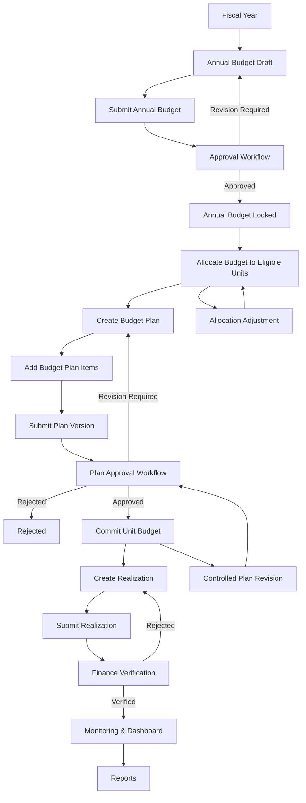
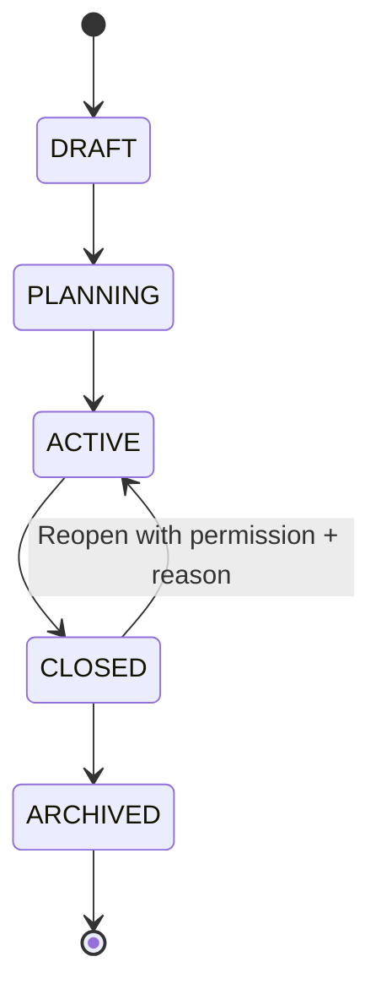
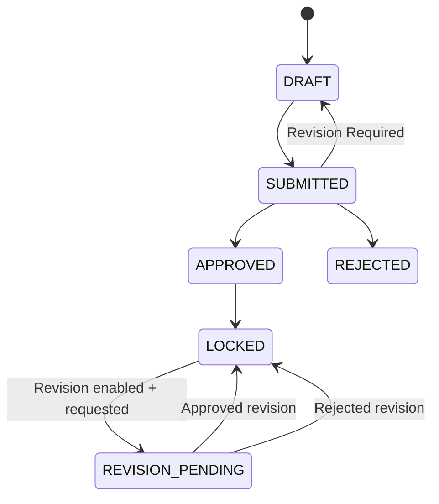
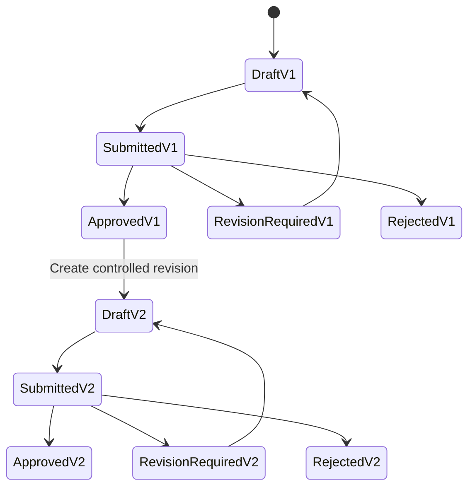
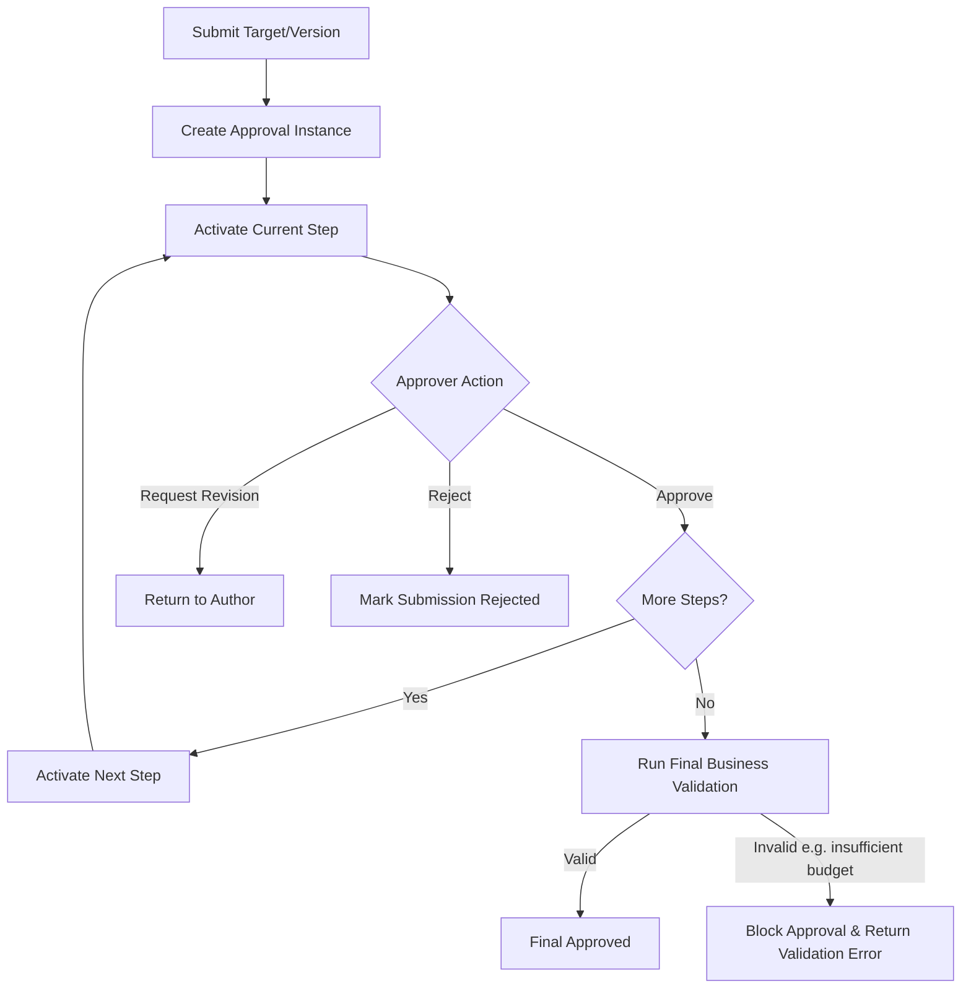
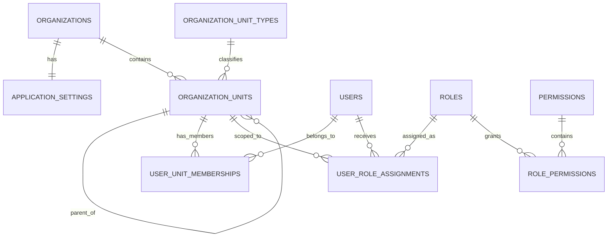
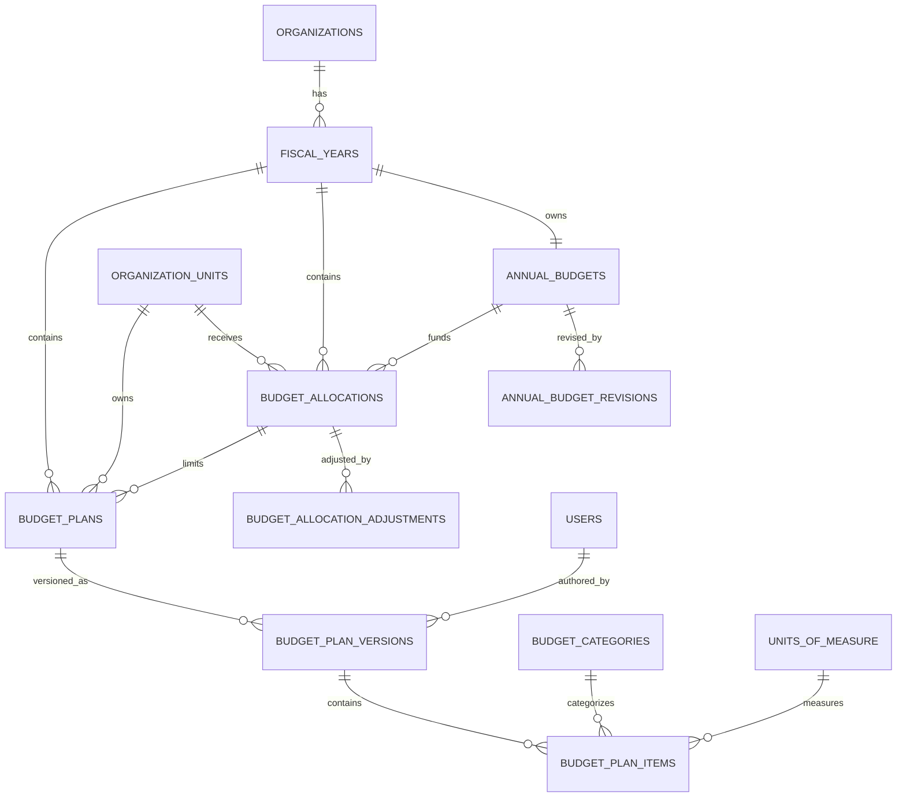
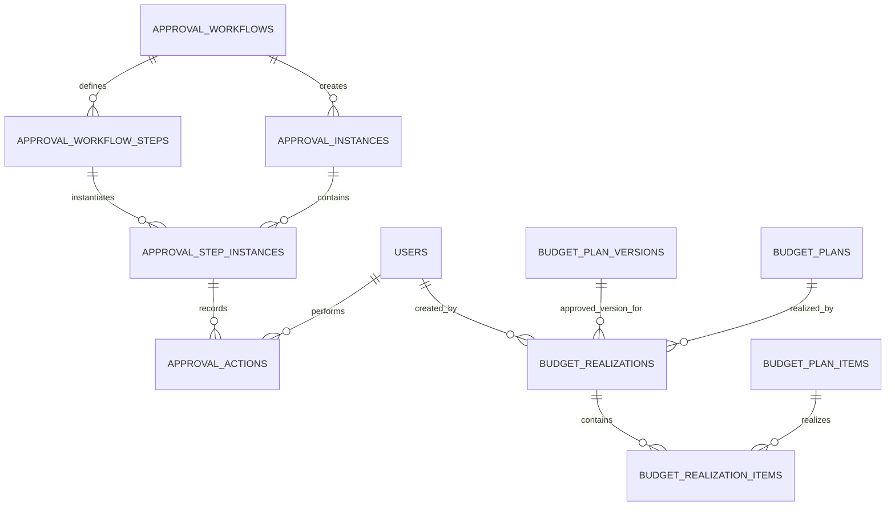
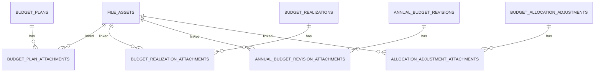

# CP-02 — Data Model & ERD Baseline

**Project:** SIMA — Sistem Informasi Monitoring Anggaran  
**Checkpoint:** CP-02  
**Version:** 1.0  
**Status:** APPROVED BASELINE FOR ARCHITECTURE & API DESIGN  
**Source:** CP-01 Requirement & Business Rules Baseline  

---

## 1. Tujuan Checkpoint

Checkpoint ini mengunci baseline data model dan hubungan entity sebelum masuk ke tahap backend architecture, frontend architecture, dan API design.

Prinsip yang digunakan:

1. satu organisasi per deployment pada V1, tetapi entity `organizations` tetap dipertahankan agar deployment lain tidak memerlukan fork source code;
2. struktur organisasi bersifat configurable dan hierarkis;
3. authorization menggunakan RBAC + data scope;
4. data finansial approved tidak ditimpa secara destruktif;
5. revision menggunakan version/history;
6. approval history bersifat append-only;
7. nilai uang menggunakan PostgreSQL `NUMERIC`, bukan floating point;
8. business rule kritis selalu divalidasi backend dan database transaction;
9. integrasi sistem keuangan masa depan disiapkan tanpa menjadikan SIMA accounting system.

---

## 2. Keputusan Final dari Draft v0.1

### DM-001 — Allocation Revision & Transfer

**Keputusan:** V1 mendukung allocation adjustment/revision. Transfer antar unit dipersiapkan sebagai fitur configurable dan **disabled by default**.

- Allocation yang sudah digunakan tidak di-overwrite langsung.
- Perubahan dicatat sebagai adjustment/revision.
- Transfer antar unit, jika diaktifkan, harus menghasilkan pengurangan sumber + penambahan tujuan secara atomik.
- Transfer membutuhkan alasan, actor, timestamp, dan approval bila policy organisasi mengharuskannya.

### DM-002 — Realization Verification

**Keputusan:** V1 mempunyai verification sederhana.

Status realization:

```text
DRAFT → SUBMITTED → VERIFIED
                  ↘ REJECTED
```

- Unit PIC dapat membuat dan submit realization sesuai permission.
- Budget Administrator/Finance verifier dapat verify/reject.
- V1 tidak menggunakan multi-level workflow untuk realization.
- Generic approval engine tetap dapat dipakai di versi berikutnya jika diperlukan.

### DM-003 — Annual Budget Approval

**Keputusan:** Annual Budget menggunakan generic approval engine yang sama dengan Budget Plan.

Default workflow V1 dapat berupa satu level `Management Approver`, tetapi jumlah step dapat dikonfigurasi.

### DM-004 — Attachment Model

**Keputusan:** attachment finansial menggunakan association table eksplisit agar foreign key tetap terjaga.

Baseline association:

- `budget_plan_attachments`
- `budget_realization_attachments`
- `annual_budget_revision_attachments`
- `allocation_adjustment_attachments`

`file_assets` hanya menyimpan metadata file dan storage reference.

### DM-005 — Vendor

**Keputusan:** V1 tidak mempunyai master vendor.

`vendor_name` disimpan sebagai text optional pada realization. Master vendor dapat ditambahkan nanti jika integrasi procurement/finance memang membutuhkannya.

### DM-006 — Job Position

**Keputusan:** V1 tidak memerlukan master `job_positions`.

`user_unit_memberships` menyimpan `job_title` sebagai text optional. Jabatan bukan sumber permission.

### DM-007 — Document Numbering

**Keputusan:** nomor dokumen menggunakan pattern configurable sederhana.

Contoh default:

```text
Budget Plan   : BP/{FY}/{UNIT}/{SEQ}
Realization   : RL/{FY}/{UNIT}/{SEQ}
Revision      : REV/{FY}/{SEQ}
Transfer      : TRF/{FY}/{SEQ}
```

Sequence harus dibuat secara aman terhadap concurrency.

### DM-008 — Budget Category Location

**Keputusan:** Budget Category berada pada **Budget Plan Item**, bukan wajib pada header.

Alasan: satu plan dapat mempunyai item dengan kategori berbeda. Header dapat menampilkan kategori dominan/`Mixed` secara derived tanpa menyimpan duplikasi sumber kebenaran.

### DM-009 — Multi Unit Membership

**Keputusan:** satu user dapat mempunyai beberapa membership aktif pada unit berbeda.

- satu membership dapat ditandai `is_primary`;
- role assignment membawa scope;
- permission tidak otomatis mengikuti job title.

### DM-010 — Fiscal Year Reopen & Approval Rollback

**Keputusan:**

- Fiscal Year `CLOSED` dapat dibuka kembali hanya dengan permission `fiscal_year.reopen`, alasan wajib, dan audit log.
- `ARCHIVED` dianggap immutable pada V1 dan tidak dapat direopen melalui UI normal.
- Approval yang sudah selesai **tidak di-rollback/edit**.
- Koreksi dilakukan melalui revision, cancellation, reversal, atau submission baru sesuai domain.
- Approval action lama tetap tersimpan.

---

## 3. Domain / Entity Baseline

### A. Organization & Identity

- `organizations`
- `application_settings`
- `organization_unit_types`
- `organization_units`
- `users`
- `user_unit_memberships`

### B. Security / RBAC

- `roles`
- `permissions`
- `role_permissions`
- `user_role_assignments`

### C. Fiscal & Budget Foundation

- `fiscal_years`
- `annual_budgets`
- `annual_budget_revisions`
- `budget_allocations`
- `budget_allocation_adjustments`
- `budget_transfers`
- `budget_categories`
- `units_of_measure`
- `document_number_settings`

### D. Budget Planning

- `budget_plans`
- `budget_plan_versions`
- `budget_plan_items`

### E. Approval

- `approval_workflows`
- `approval_workflow_steps`
- `approval_instances`
- `approval_step_instances`
- `approval_actions`

### F. Realization

- `budget_realizations`
- `budget_realization_items`

### G. Files / Notification / Audit

- `file_assets`
- `budget_plan_attachments`
- `budget_realization_attachments`
- `annual_budget_revision_attachments`
- `allocation_adjustment_attachments`
- `notifications`
- `audit_logs`

---

## 4. High-Level Business Flow



---

## 5. Fiscal Year & Annual Budget Lifecycle



Annual Budget lifecycle:



---

## 6. Budget Plan Lifecycle

Approval state dan execution state disimpan terpisah.

### Workflow status

```text
DRAFT
SUBMITTED
UNDER_REVIEW
REVISION_REQUIRED
APPROVED
REJECTED
CANCELLED
```

### Execution status

```text
NOT_STARTED
IN_PROGRESS
PARTIALLY_REALIZED
FULLY_REALIZED
CLOSED
```

Plan version flow:



---

## 7. Approval Flow



Rules:

- step berjalan berurutan;
- self-approval default OFF;
- reject/request revision wajib komentar;
- final approval plan melakukan recheck saldo di database transaction;
- approval actions bersifat append-only.

---

## 8. Organization & RBAC ERD



---

## 9. Budget Planning ERD



---

## 10. Approval & Realization ERD



`approval_instances.target_type + target_id` digunakan sebagai generic target reference pada V1. Service layer wajib memvalidasi bahwa target valid untuk workflow yang dipilih.

---

## 11. File Attachment ERD



---

## 12. Core Field Baseline

### `organizations`

- `id UUID PK`
- `code VARCHAR UNIQUE`
- `name VARCHAR`
- `legal_name VARCHAR NULL`
- `is_active BOOLEAN`
- timestamps

### `application_settings`

- `id UUID PK`
- `organization_id UUID UNIQUE FK`
- `application_name`
- `application_short_name`
- `organization_display_name`
- `logo_file_id NULL`
- `favicon_file_id NULL`
- `primary_color NULL`
- `secondary_color NULL`
- `currency_code DEFAULT 'IDR'`
- `timezone DEFAULT 'Asia/Jakarta'`
- `date_format DEFAULT 'DD/MM/YYYY'`
- `allow_annual_budget_revision BOOLEAN DEFAULT false`
- `allow_budget_transfer BOOLEAN DEFAULT false`
- `allow_self_approval BOOLEAN DEFAULT false`
- timestamps

### `organization_units`

- `id UUID PK`
- `organization_id FK`
- `unit_type_id FK`
- `parent_id self-FK NULL`
- `code VARCHAR`
- `name VARCHAR`
- `can_receive_budget BOOLEAN`
- `can_create_budget_plan BOOLEAN`
- `is_active BOOLEAN`
- timestamps

Constraint:

```text
UNIQUE (organization_id, code)
```

### `users`

- `id UUID PK`
- `username VARCHAR UNIQUE`
- `email VARCHAR NULL`
- `full_name VARCHAR`
- `password_hash VARCHAR`
- `is_active BOOLEAN`
- `is_locked BOOLEAN`
- `last_login_at TIMESTAMPTZ NULL`
- timestamps

### `user_unit_memberships`

- `id UUID PK`
- `user_id FK`
- `organization_unit_id FK`
- `job_title VARCHAR NULL`
- `is_primary BOOLEAN`
- `start_at DATE/TIMESTAMPTZ`
- `end_at NULL`

### `roles`

- `id UUID PK`
- `organization_id FK`
- `code VARCHAR`
- `name VARCHAR`
- `description NULL`
- `is_system_role BOOLEAN`
- `is_active BOOLEAN`

### `permissions`

- `id UUID PK`
- `code VARCHAR UNIQUE`
- `name VARCHAR`
- `module VARCHAR`

### `user_role_assignments`

- `id UUID PK`
- `user_id FK`
- `role_id FK`
- `scope_type ENUM/TEXT`
- `scope_unit_id FK NULL`
- `valid_from NULL`
- `valid_until NULL`

Allowed `scope_type`:

```text
OWN
OWN_UNIT
OWN_UNIT_AND_CHILDREN
ALL
```

### `fiscal_years`

- `id UUID PK`
- `organization_id FK`
- `code VARCHAR`
- `year INT NULL`
- `start_date DATE`
- `end_date DATE`
- `status`
- `reopened_at NULL`
- `reopened_by NULL`
- `reopen_reason NULL`
- timestamps

Constraints:

- `start_date < end_date`;
- `UNIQUE (organization_id, code)`;
- hanya satu `ACTIVE` per organization melalui partial unique index atau transaction guard.

### `annual_budgets`

- `id UUID PK`
- `fiscal_year_id UUID UNIQUE FK`
- `initial_amount NUMERIC(20,2)`
- `current_amount NUMERIC(20,2)`
- `status`
- `created_by FK`
- `approved_at NULL`
- `locked_at NULL`
- timestamps

### `annual_budget_revisions`

- `id UUID PK`
- `annual_budget_id FK`
- `revision_number INT`
- `previous_amount NUMERIC(20,2)`
- `proposed_amount NUMERIC(20,2)`
- `difference_amount NUMERIC(20,2)`
- `reason TEXT`
- `status`
- `requested_by FK`
- `approved_at NULL`
- timestamps

### `budget_allocations`

- `id UUID PK`
- `annual_budget_id FK`
- `fiscal_year_id FK`
- `organization_unit_id FK`
- `initial_amount NUMERIC(20,2)`
- `current_amount NUMERIC(20,2)`
- `status`
- timestamps

Constraint:

```text
UNIQUE (fiscal_year_id, organization_unit_id)
```

### `budget_allocation_adjustments`

- `id UUID PK`
- `budget_allocation_id FK`
- `adjustment_number VARCHAR`
- `adjustment_type` (`INCREASE`, `DECREASE`, `CORRECTION`, `TRANSFER_IN`, `TRANSFER_OUT`)
- `amount NUMERIC(20,2)`
- `previous_amount NUMERIC(20,2)`
- `resulting_amount NUMERIC(20,2)`
- `reason TEXT`
- `status`
- `created_by FK`
- timestamps

### `budget_transfers`

- `id UUID PK`
- `fiscal_year_id FK`
- `transfer_number VARCHAR`
- `source_allocation_id FK`
- `destination_allocation_id FK`
- `amount NUMERIC(20,2)`
- `reason TEXT`
- `status`
- `created_by FK`
- timestamps

Transfer completion harus atomic dan menghasilkan adjustment source/destination.

### `budget_categories`

- `id UUID PK`
- `organization_id FK`
- `code VARCHAR`
- `name VARCHAR`
- `description NULL`
- `is_active BOOLEAN`
- timestamps

### `units_of_measure`

- `id UUID PK`
- `organization_id FK`
- `code VARCHAR`
- `name VARCHAR`
- `is_active BOOLEAN`

### `budget_plans`

- `id UUID PK`
- `fiscal_year_id FK`
- `organization_unit_id FK`
- `budget_allocation_id FK`
- `plan_number VARCHAR`
- `workflow_status`
- `execution_status`
- `current_version_id FK NULL`
- `approved_version_id FK NULL`
- `created_by FK`
- timestamps

Constraint:

```text
UNIQUE (fiscal_year_id, plan_number)
```

### `budget_plan_versions`

- `id UUID PK`
- `budget_plan_id FK`
- `version_number INT`
- `title VARCHAR`
- `description TEXT NULL`
- `pic_user_id FK NULL`
- `total_amount NUMERIC(20,2)`
- `revision_reason TEXT NULL`
- `created_by FK`
- `created_at`

Constraint:

```text
UNIQUE (budget_plan_id, version_number)
```

### `budget_plan_items`

- `id UUID PK`
- `budget_plan_version_id FK`
- `line_number INT`
- `description VARCHAR/TEXT`
- `budget_category_id FK`
- `unit_of_measure_id FK NULL`
- `quantity NUMERIC(18,4)`
- `unit_price NUMERIC(20,2)`
- `subtotal NUMERIC(20,2)`
- `notes TEXT NULL`

Backend wajib menghitung/verifikasi:

```text
subtotal = quantity × unit_price
```

### `approval_workflows`

- `id UUID PK`
- `organization_id FK`
- `code VARCHAR`
- `name VARCHAR`
- `target_type`
- `is_active BOOLEAN`

### `approval_workflow_steps`

- `id UUID PK`
- `workflow_id FK`
- `step_order INT`
- `required_role_id FK NULL`
- `required_permission_code VARCHAR NULL`
- `scope_rule NULL`
- `minimum_amount NUMERIC NULL`
- `maximum_amount NUMERIC NULL`

### `approval_instances`

- `id UUID PK`
- `workflow_id FK`
- `target_type VARCHAR`
- `target_id UUID`
- `status`
- `submitted_by FK`
- `submitted_at`
- `completed_at NULL`

### `approval_step_instances`

- `id UUID PK`
- `approval_instance_id FK`
- `workflow_step_id FK`
- `step_order INT`
- `status`
- `assigned_role_id FK NULL`
- timestamps

### `approval_actions`

- `id UUID PK`
- `step_instance_id FK`
- `actor_user_id FK`
- `action` (`APPROVE`, `REJECT`, `REQUEST_REVISION`)
- `comment TEXT NULL`
- `acted_at`

### `budget_realizations`

- `id UUID PK`
- `budget_plan_id FK`
- `approved_plan_version_id FK`
- `realization_number VARCHAR`
- `transaction_date DATE`
- `description TEXT`
- `reference_number VARCHAR NULL`
- `vendor_name VARCHAR NULL`
- `source` default `MANUAL`
- `external_system VARCHAR NULL`
- `external_reference VARCHAR NULL`
- `status` (`DRAFT`, `SUBMITTED`, `VERIFIED`, `REJECTED`, `CANCELLED`, `REVERSED`)
- `created_by FK`
- `verified_by FK NULL`
- `verified_at NULL`
- timestamps

### `budget_realization_items`

- `id UUID PK`
- `budget_realization_id FK`
- `budget_plan_item_id FK`
- `description TEXT`
- `quantity NUMERIC NULL`
- `unit_price NUMERIC NULL`
- `amount NUMERIC(20,2)`

### `file_assets`

- `id UUID PK`
- `organization_id FK`
- `original_filename`
- `stored_filename/storage_key`
- `mime_type`
- `size_bytes`
- `checksum NULL`
- `uploaded_by FK`
- `created_at`

### `notifications`

- `id UUID PK`
- `user_id FK`
- `type`
- `title`
- `message`
- `entity_type NULL`
- `entity_id NULL`
- `read_at NULL`
- `created_at`

### `audit_logs`

- `id UUID PK`
- `organization_id FK`
- `actor_user_id FK NULL`
- `action`
- `entity_type`
- `entity_id UUID NULL`
- `before_data JSONB NULL`
- `after_data JSONB NULL`
- `metadata JSONB NULL`
- `created_at`

Audit log append-only dari perspektif aplikasi.

---

## 13. Budget Calculation Baseline

Untuk satu unit dan Fiscal Year:

```text
Allocation = current allocation amount
Pipeline   = total plan Draft/Submitted/Under Review (informational)
Committed  = total amount current approved plan versions yang belum cancelled
Realized   = total VERIFIED realization
Available  = Allocation - Committed
Unrealized Commitment = Committed - Realized
```

Catatan:

- Pipeline tidak mengurangi Available.
- Realized merupakan bagian dari Committed, bukan tambahan di luar Committed.
- Plan final approval harus lock/check allocation row atau mekanisme concurrency equivalent.
- Dua approval paralel tidak boleh menghasilkan `Committed > Allocation`.

---

## 14. Realization Calculation Baseline

Untuk plan approved:

```text
Approved Plan Amount = total approved plan version
Verified Realization = SUM(verified realization items)
Remaining to Realize = Approved Plan Amount - Verified Realization
```

Default policy:

```text
Verified Realization <= Approved Plan Amount
```

V1 memakai policy `STRICT`.

---

## 15. Delete / Mutation Rules at Data Model Level

- Draft tanpa dependent transaction dapat dihapus sesuai permission.
- Submitted/Approved/Realized financial record tidak di-hard-delete melalui business API.
- Master data yang pernah direferensikan menggunakan `is_active=false`.
- Approval actions tidak diedit/dihapus.
- Verified realization yang salah dikoreksi dengan reversal/correction, bukan delete.
- Approved plan diubah melalui version/revision, bukan overwrite.

---

## 16. Data Integrity & Concurrency Rules

Database/API implementation wajib menjaga:

1. satu Annual Budget per Fiscal Year;
2. satu allocation per unit per Fiscal Year;
3. allocation total tidak melebihi Annual Budget;
4. committed total unit tidak melebihi allocation;
5. verified realization tidak melebihi approved plan pada policy STRICT;
6. version number unik per plan;
7. document number unik pada scope yang ditentukan;
8. approval step order konsisten;
9. self-approval dicegah jika policy OFF;
10. financial finalization memakai database transaction dan appropriate row locking/serializable strategy.

---

## 17. Integration Boundary

SIMA tidak menjadi system of record untuk:

- General Ledger;
- journal debit/credit;
- full COA maintenance;
- payment execution;
- procurement lifecycle penuh;
- vendor master pada V1.

Integration-ready fields tersedia pada realization:

```text
source
external_system
external_reference
```

COA/account code dapat ditambahkan sebagai optional reference setelah aplikasi Finance diketahui.

---

## 18. Diagram Source Files

Checkpoint package menyediakan Mermaid source terpisah untuk:

1. `01-business-flow.mmd`
2. `02-fiscal-budget-lifecycle.mmd`
3. `03-plan-lifecycle.mmd`
4. `04-approval-flow.mmd`
5. `05-organization-rbac-erd.mmd`
6. `06-budget-planning-erd.mmd`
7. `07-approval-realization-erd.mmd`
8. `08-attachment-erd.mmd`

Diagram source disimpan sebagai text agar mudah di-version-control di GitHub.

---

## 19. Open Items Setelah CP-02

Tidak ada open item yang **memblokir Architecture/API Design**.

Hal berikut sengaja dibiarkan configurable/future-ready dan tidak perlu diputuskan sekarang:

- integrasi COA dengan sistem keuangan;
- master vendor;
- multi-level realization approval;
- budget transfer enable/disable;
- annual budget revision enable/disable;
- exact approval role/jabatan universitas;
- format document number final;
- storage provider production untuk attachment.

Keputusan tersebut dapat diselesaikan melalui Application Settings, configuration, atau checkpoint berikutnya tanpa mengubah fondasi utama data model.

---

## 20. Baseline Result

CP-02 dinyatakan cukup stabil untuk melanjutkan ke:

**CP-03 — Application Architecture & API Baseline**

Tahap berikutnya akan menentukan:

- backend modular architecture FastAPI;
- frontend architecture React + TypeScript;
- authentication/session strategy;
- API conventions dan versioning;
- repository/monorepo structure;
- service/repository/domain boundaries;
- database migration strategy;
- file storage abstraction;
- error response standard;
- logging & audit integration;
- background task policy;
- API endpoint map awal;
- development environment conventions.
