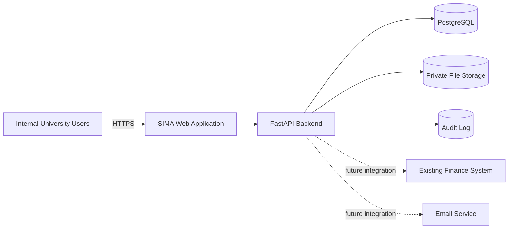
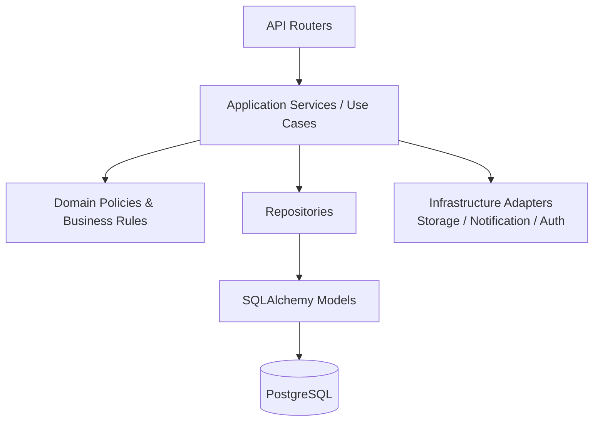
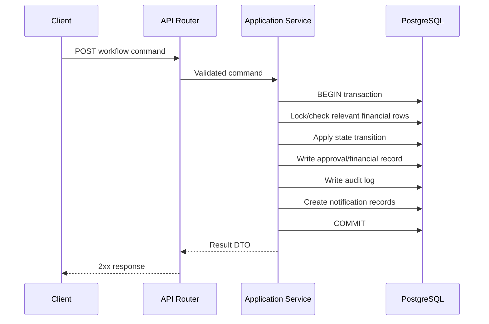
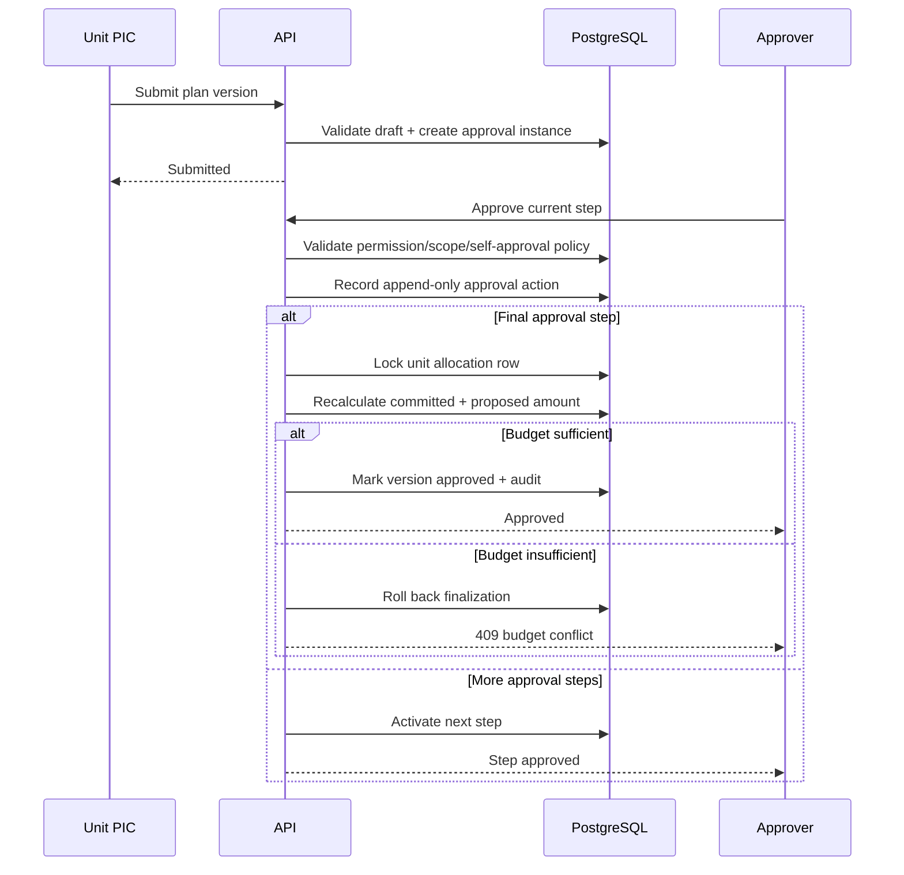

# CP-03 — Application Architecture & API Baseline

**Project:** SIMA — Sistem Informasi Monitoring Anggaran  
**Checkpoint:** CP-03  
**Version:** 1.0  
**Status:** APPROVED BASELINE FOR UI/UX & DEVELOPMENT READINESS  
**Depends on:** CP-01 Requirement & Business Rules Baseline, CP-02 Data Model & ERD Baseline

---

## 1. Tujuan Checkpoint

Checkpoint ini mengunci baseline arsitektur aplikasi sebelum masuk ke desain UI/UX dan development readiness.

Fokus CP-03:

1. struktur monorepo;
2. arsitektur backend FastAPI;
3. arsitektur frontend React + TypeScript;
4. authentication dan session;
5. authorization RBAC + data scope;
6. API versioning dan convention;
7. transaction, concurrency, dan audit integration;
8. database migration;
9. file storage abstraction;
10. logging dan error handling;
11. notification/background processing policy;
12. endpoint map awal;
13. testing boundary pada level architecture.

CP-03 tidak menentukan detail visual UI. Hal tersebut menjadi CP-04.

---

## 2. Architecture Decision Summary

### AR-001 — Architecture Style

**Keputusan:** V1 menggunakan **Modular Monolith**.

Alasan:

- domain cukup besar tetapi belum membutuhkan operational complexity microservices;
- transaction finansial lebih mudah dijaga dalam satu database;
- development dan deployment lebih sederhana;
- modul tetap dipisahkan agar dapat diekstrak di masa depan bila benar-benar diperlukan.

Tidak menggunakan microservices pada V1.

### AR-002 — Repository Strategy

**Keputusan:** satu **monorepo** untuk frontend, backend, docs, tests, scripts, dan deployment configuration.

Nama repository baseline:

```text
sima-budget
```

Nama repository bersifat teknis dan tidak harus mengikuti branding aplikasi yang dapat diubah melalui Settings.

### AR-003 — Production Topology

**Keputusan:** satu public origin melalui reverse proxy.

```text
Browser
   ↓ HTTPS
Reverse Proxy
   ├── /        → React SPA
   └── /api/v1  → FastAPI
                   ↓
                PostgreSQL
                   ↓
             Private File Storage
```

Keuntungan:

- cookie/session lebih sederhana dan aman;
- CORS production dapat dibuat sangat ketat;
- frontend/backend tidak perlu exposed pada domain berbeda.

### AR-004 — Backend Stack

Baseline:

- Python;
- FastAPI;
- SQLAlchemy 2 style;
- PostgreSQL;
- Alembic;
- Pydantic;
- pytest;
- Ruff;
- type checking pada CI.

Versi dependency final akan dikunci pada CP-05/development setup, bukan pada CP-03.

### AR-005 — Frontend Stack

Baseline:

- React;
- TypeScript;
- Vite;
- React Router;
- TanStack Query untuk server state;
- React Hook Form untuk form state;
- Zod untuk client-side schema/form validation;
- typed/generated API client dari OpenAPI.

Global state library berat seperti Redux **tidak digunakan secara default**. State lokal, URL state, TanStack Query, dan auth context/store kecil digunakan terlebih dahulu.

### AR-006 — Database

**Keputusan:** PostgreSQL merupakan authoritative relational datastore SIMA.

Redis **tidak digunakan pada V1** kecuali kemudian muncul kebutuhan nyata seperti distributed queue/cache/rate limiting yang tidak dapat ditangani secara sederhana.

---

## 3. System Context



SIMA tetap terpisah dari SIAKAD, HRIS, accounting/finance system, procurement, dan ERP lain. Integrasi dilakukan melalui API/import adapter bila requirement sudah diketahui.

---

## 4. Monorepo Baseline

```text
sima-budget/
├── apps/
│   ├── backend/
│   │   ├── app/
│   │   ├── migrations/
│   │   ├── tests/
│   │   ├── pyproject.toml
│   │   └── alembic.ini
│   │
│   └── frontend/
│       ├── src/
│       ├── public/
│       ├── tests/
│       ├── package.json
│       └── vite.config.ts
│
├── docs/
│   ├── project-context/
│   ├── checkpoints/
│   ├── architecture/
│   ├── api/
│   ├── database/
│   ├── installation/
│   ├── user-guide/
│   └── testing/
│
├── test-cases/
├── logs/
│   └── testing/
├── scripts/
├── docker/
├── .github/
│   └── workflows/
├── .editorconfig
├── .gitignore
├── .env.example
├── compose.yaml
├── Makefile
├── README.md
├── CONTRIBUTING.md
├── SECURITY.md
└── CHANGELOG.md
```

Catatan:

- `logs/testing/` dapat dipakai untuk test execution report lokal/manual sesuai requirement project;
- runtime application log production **tidak** harus disimpan ke Git repository;
- secret dan `.env` asli tidak pernah di-commit.

---

## 5. Backend Modular Architecture

Backend menggunakan **feature/domain-first structure**, bukan satu folder global besar berisi seluruh model/service aplikasi.

Baseline:

```text
apps/backend/app/
├── main.py
├── core/
│   ├── config.py
│   ├── database.py
│   ├── security.py
│   ├── errors.py
│   ├── logging.py
│   ├── middleware.py
│   └── pagination.py
│
├── shared/
│   ├── enums/
│   ├── schemas/
│   ├── utilities/
│   └── storage/
│
└── modules/
    ├── auth/
    ├── users/
    ├── roles/
    ├── organization_units/
    ├── fiscal_years/
    ├── annual_budgets/
    ├── allocations/
    ├── budget_categories/
    ├── budget_plans/
    ├── approvals/
    ├── realizations/
    ├── reports/
    ├── files/
    ├── notifications/
    ├── audit/
    └── settings/
```

Setiap module dapat memiliki:

```text
module_name/
├── api.py
├── schemas.py
├── models.py
├── repository.py
├── service.py
├── policies.py
├── exceptions.py
└── dependencies.py
```

Tidak semua module wajib mempunyai semua file. Hindari boilerplate yang tidak memberi nilai.

---

## 6. Backend Responsibility Boundary



### API/router layer

Tanggung jawab:

- HTTP request/response;
- dependency injection;
- authentication dependency;
- parsing/filter/pagination;
- response status code.

Tidak boleh berisi business rule finansial utama.

### Application service/use-case layer

Tanggung jawab:

- orchestration use case;
- transaction boundary;
- pemanggilan policy;
- repository coordination;
- audit/notification creation.

Contoh:

```text
SubmitBudgetPlan
ApproveBudgetPlanStep
VerifyRealization
AdjustUnitAllocation
CloseFiscalYear
```

### Domain policy/business rule layer

Berisi rule seperti:

```text
CanSubmitPlan
CanApprovePlan
CanCommitAmount
CanVerifyRealization
CanReopenFiscalYear
```

Policy harus dapat diuji tanpa HTTP layer.

### Repository layer

Tanggung jawab:

- query/persistence;
- row locking;
- aggregate loading;
- database-specific operations.

Repository tidak memutuskan policy bisnis.

---

## 7. Database Access Strategy

### DB-001

Gunakan SQLAlchemy session dengan transaction boundary eksplisit pada application service.

### DB-002

Command finansial kritis harus atomic.

Contoh final approval plan:

1. begin transaction;
2. lock relevant allocation record;
3. hitung ulang committed amount;
4. validasi proposed approved amount;
5. simpan approval action;
6. finalisasi plan version;
7. tulis audit log;
8. buat notification record;
9. commit.

Jika salah satu gagal, seluruh transaction rollback.

### DB-003

Pengecekan finansial tidak boleh hanya dilakukan frontend.

### DB-004

Untuk race condition gunakan row lock/transaction strategy yang sesuai. Final approval tidak boleh menghasilkan `Committed > Allocation` walaupun dua request terjadi bersamaan.

### DB-005

Migration schema hanya melalui Alembic migration yang version-controlled. Perubahan manual production database tidak dianggap workflow normal.

---

## 8. Technical Persistence Tables

CP-02 mengunci **business data model**. CP-03 menambahkan technical/infrastructure persistence yang tidak mengubah business ERD utama.

Baseline tambahan:

### `user_sessions`

- `id UUID PK`
- `user_id FK`
- `token_hash`
- `csrf_secret/hash` sesuai implementation
- `created_at`
- `last_seen_at`
- `expires_at`
- `revoked_at NULL`
- `ip_address NULL`
- `user_agent NULL`

Session token mentah tidak disimpan di database.

### `password_reset_tokens` (jika forgot-password diaktifkan)

- hashed token;
- user;
- expiry;
- used/revoked state.

### Optional future technical tables

- integration sync logs;
- job/outbox tables;
- idempotency records.

Tidak dibuat sampai kebutuhan implementasi nyata muncul.

---

## 9. Authentication Strategy

### AUTH-001 — Browser Authentication

**Keputusan:** V1 menggunakan **server-side opaque session** melalui cookie, bukan menyimpan access token di `localStorage`.

Cookie session:

```text
HttpOnly = true
Secure   = true pada production
SameSite = Lax secara default
Path     = /
```

Browser hanya memegang random session token. Database menyimpan hash session token.

Alasan:

- session dapat dicabut secara server-side;
- logout semua device mudah;
- mengurangi exposure token ke JavaScript;
- cocok untuk aplikasi internal browser berbasis satu origin.

### AUTH-002 — CSRF

Karena authentication menggunakan cookie, state-changing request wajib memiliki CSRF protection.

Baseline:

- SameSite cookie;
- CSRF token/header untuk `POST`, `PUT`, `PATCH`, `DELETE` dan command mutation;
- request origin validation pada production.

### AUTH-003 — Password

Baseline security:

- password hashing menggunakan Argon2id melalui library yang terpelihara;
- minimum password default 12 karakter;
- tidak menyimpan plaintext/reversible password;
- tidak memaksa periodic password rotation tanpa alasan keamanan;
- account dapat di-lock/disable;
- password reset menghasilkan token sekali pakai dan kadaluarsa.

### AUTH-004 — Session Lifetime

Default proposed:

- idle timeout: 30 menit;
- absolute lifetime: 12 jam;
- configurable pada application/security configuration;
- privilege/security change dapat memaksa session revoke.

### AUTH-005 — Future SSO

Authentication provider dibuat terpisah agar di masa depan dapat mendukung Microsoft/Google/LDAP/SSO tanpa mengubah authorization model.

---

## 10. Authorization Strategy

Authorization terdiri dari:

```text
Permission + Scope + Resource Context + Domain Policy
```

Contoh:

```text
permission : plan.view
scope      : OWN_UNIT_AND_CHILDREN
resource   : Budget Plan milik Prodi X
```

Backend melakukan seluruh keputusan final authorization.

### Scope baseline

```text
OWN
OWN_UNIT
OWN_UNIT_AND_CHILDREN
ALL
```

### Rules

1. nama jabatan bukan sumber permission;
2. frontend boleh menyembunyikan tombol tetapi bukan security boundary;
3. setiap mutation memvalidasi permission + scope;
4. self-approval policy diperiksa saat command approval;
5. perubahan permission/role dicatat Audit Log.

---

## 11. API Versioning

Semua business API V1 berada pada:

```text
/api/v1
```

Contoh:

```text
GET /api/v1/fiscal-years
GET /api/v1/budget-plans/{id}
POST /api/v1/budget-plans/{id}/submit
```

Breaking API changes di masa depan menggunakan `/api/v2`, bukan mengubah behavior lama secara diam-diam.

OpenAPI FastAPI menjadi source contract API.

---

## 12. API Naming & JSON Convention

### URL

- lowercase;
- plural resource nouns;
- kebab-case bila lebih dari satu kata.

Contoh:

```text
/organization-units
/budget-plans
/budget-categories
```

### JSON

Baseline API menggunakan `snake_case` secara konsisten agar sesuai schema Python dan OpenAPI tanpa mapping tersembunyi.

Contoh:

```json
{
  "plan_number": "BP/2027/FT/0001",
  "workflow_status": "APPROVED",
  "total_amount": "150000000.00"
}
```

Nilai uang di JSON dikirim sebagai decimal-safe representation, **bukan bergantung pada binary floating point**.

Frontend typed client mengikuti schema OpenAPI tersebut.

---

## 13. REST Resource vs Command Endpoint

CRUD biasa menggunakan resource endpoint.

Contoh:

```text
POST   /budget-plans
GET    /budget-plans/{id}
PATCH  /budget-plans/{id}
```

Tetapi transition bisnis menggunakan **command endpoint eksplisit**.

Contoh:

```text
POST /budget-plans/{id}/submit
POST /approval-steps/{id}/approve
POST /approval-steps/{id}/reject
POST /approval-steps/{id}/request-revision
POST /realizations/{id}/submit
POST /realizations/{id}/verify
POST /fiscal-years/{id}/close
POST /fiscal-years/{id}/reopen
```

Tidak diperbolehkan mengubah workflow status finansial hanya dengan generic `PATCH status=APPROVED`.

---

## 14. HTTP Status Baseline

```text
200 OK            read/update/command result
201 Created       create resource
204 No Content    successful action tanpa body bila sesuai
400 Bad Request   malformed business input
401 Unauthorized  belum login/session invalid
403 Forbidden     tidak punya permission/scope
404 Not Found     resource tidak ada/tidak visible
409 Conflict      state/concurrency/business conflict
422 Unprocessable schema/field validation
429 Too Many Requests bila rate limiting aktif
500 Internal Server Error unexpected server error
```

Contoh `409 Conflict`:

- saldo allocation berubah dan final approval tidak lagi cukup;
- record sudah diproses oleh request lain;
- transition state tidak lagi valid.

---

## 15. Standard Error Response

Gunakan format problem-details-inspired:

```json
{
  "type": "https://sima.local/problems/budget-insufficient",
  "title": "Budget tidak mencukupi",
  "status": 409,
  "code": "BUDGET_INSUFFICIENT",
  "detail": "Saldo unit tidak cukup untuk menyetujui rencana ini.",
  "trace_id": "...",
  "field_errors": []
}
```

`code` stabil digunakan frontend untuk behavior/translation.

Stack trace dan internal SQL error tidak dikirim ke browser.

---

## 16. List, Filter, Sort & Pagination Convention

Baseline query:

```text
?page=1
&page_size=25
&search=...
&sort=-created_at
&status=APPROVED
```

Default:

```text
page = 1
page_size = 25
max page_size = 100
```

Response:

```json
{
  "items": [],
  "pagination": {
    "page": 1,
    "page_size": 25,
    "total_items": 0,
    "total_pages": 0
  }
}
```

Filter khusus resource didefinisikan per endpoint. Query tidak boleh mengizinkan arbitrary SQL-like field injection.

---

## 17. API Response DTO Policy

API tidak mengembalikan ORM object secara langsung.

Semua response melalui explicit Pydantic response schema/DTO.

Tujuan:

- mencegah accidental exposure password hash/internal field;
- API contract stabil;
- entity DB dapat berevolusi tanpa langsung merusak frontend.

---

## 18. Frontend Architecture

Baseline feature-first:

```text
apps/frontend/src/
├── app/
│   ├── router/
│   ├── providers/
│   └── layouts/
│
├── features/
│   ├── auth/
│   ├── dashboard/
│   ├── users/
│   ├── roles/
│   ├── organization-units/
│   ├── fiscal-years/
│   ├── annual-budgets/
│   ├── allocations/
│   ├── budget-plans/
│   ├── approvals/
│   ├── realizations/
│   ├── reports/
│   ├── audit/
│   └── settings/
│
├── shared/
│   ├── api/
│   ├── components/
│   ├── forms/
│   ├── hooks/
│   ├── lib/
│   ├── types/
│   └── utils/
│
└── main.tsx
```

Setiap feature dapat memiliki:

```text
components/
pages/
queries/
mutations/
schemas/
utils/
```

Tidak membuat satu folder global `components/` berisi seluruh component aplikasi tanpa domain ownership.

---

## 19. Frontend State Strategy

### Server state

TanStack Query:

- list/detail fetching;
- caching;
- invalidation;
- mutation state;
- background refetch bila sesuai.

### Form state

React Hook Form + Zod.

### URL state

Filter, pagination, tab, dan search yang perlu dapat dibookmark disimpan di URL query string.

### Global client state

Hanya untuk state yang benar-benar global seperti:

- current user/session info;
- theme preference;
- UI-level state tertentu.

Jangan menduplikasi server data besar ke global store.

---

## 20. Typed API Client

FastAPI OpenAPI digunakan untuk menghasilkan atau memvalidasi typed frontend client/types.

Tujuan:

- TypeScript type tidak ditulis ulang manual untuk setiap endpoint;
- breaking contract cepat terdeteksi CI;
- frontend/backend tetap sinkron.

Tool code generation final dipilih pada CP-05 berdasarkan dependency yang stabil saat implementasi.

---

## 21. Frontend Permission Handling

Frontend menerima current-user capability/context dari endpoint seperti:

```text
GET /api/v1/auth/me
```

Response dapat memuat:

- user profile;
- memberships;
- effective permissions;
- effective role assignments;
- relevant scopes.

Frontend menggunakan ini untuk UX:

```text
hide/disable button
hide inaccessible menu
show read-only mode
```

Tetapi backend tetap authoritative.

---

## 22. File Storage Architecture

File binary **tidak disimpan di PostgreSQL**.

Database hanya menyimpan metadata pada `file_assets`.

Storage melalui interface/adapter:

```text
StorageService
├── LocalPrivateStorage     (development)
└── S3CompatibleStorage     (production-ready option)
```

Production storage provider final dapat dipilih kemudian tanpa mengubah business module.

### Upload flow

1. permission validation;
2. validate MIME/type/extension/size;
3. generate safe storage key;
4. store private object;
5. calculate/store checksum bila digunakan;
6. create `file_assets` + association;
7. audit sensitive upload bila perlu.

### Download

Tidak expose arbitrary filesystem path/public bucket URL.

User mengakses melalui authorized download endpoint atau short-lived signed URL setelah permission check.

---

## 23. File Security Baseline

- filename dari user tidak digunakan langsung sebagai server path;
- object key generated oleh server;
- whitelist file type per domain;
- maximum size configurable;
- file metadata dipisahkan dari file content;
- upload path private;
- executable file types ditolak secara default;
- malware scanning dapat ditambahkan sebagai adapter/future capability.

---

## 24. Audit Integration

Audit Log berbeda dari technical application log.

### Audit log

Menjawab:

```text
WHO changed WHAT, WHEN, and from/to WHAT
```

Untuk financial mutation, audit write dilakukan dalam transaction yang sama bila memungkinkan.

### Technical log

Untuk:

- request trace;
- exceptions;
- performance/operational issue;
- integration error.

Technical log tidak boleh secara sengaja menyimpan password, session token, secret, atau isi file sensitif.

---

## 25. Logging & Trace ID

Setiap incoming request mendapat `trace_id/request_id`.

ID tersebut:

- masuk structured application log;
- dikembalikan pada error response;
- dapat dimasukkan ke audit metadata bila berguna.

Production log diarahkan ke stdout/central log collector sesuai deployment, bukan bergantung pada file log lokal di source repository.

---

## 26. Notification Architecture

V1 notification utama adalah **in-app notification** yang persisted pada database.

Contoh event:

```text
PLAN_SUBMITTED
APPROVAL_REQUIRED
PLAN_APPROVED
PLAN_REJECTED
PLAN_REVISION_REQUIRED
REALIZATION_SUBMITTED
REALIZATION_VERIFIED
BUDGET_THRESHOLD_WARNING
```

Notification record yang penting dibuat saat transaction bisnis berhasil.

Email notification tidak menjadi dependency core V1. Jika ditambahkan, gunakan notification adapter.

---

## 27. Background Job Policy

V1 **tidak menggunakan Celery/Redis queue secara default**.

Prinsip:

- operasi finansial penting harus synchronous/transactional;
- FastAPI `BackgroundTasks` hanya untuk pekerjaan best-effort/non-critical;
- critical asynchronous work di masa depan harus menggunakan durable queue/outbox, bukan in-memory background task.

Contoh future durable jobs:

- bulk email;
- large report generation;
- finance-system synchronization;
- scheduled reminder;
- file malware scan.

---

## 28. Report Architecture

Report terdiri dari dua bentuk:

1. query/report API untuk dashboard/table;
2. export adapter untuk PDF/Excel/CSV.

Business calculation harus menggunakan service/query layer yang sama agar angka dashboard dan export tidak memiliki formula berbeda.

Report tidak boleh menghitung financial truth menggunakan data frontend.

Untuk export besar di masa depan dapat dipindahkan ke background job.

---

## 29. Caching Policy

Tidak ada distributed cache pada V1.

Alasan:

- correctness lebih penting daripada premature optimization;
- skala awal belum membuktikan kebutuhan;
- PostgreSQL + query/index yang baik cukup untuk baseline.

Caching dapat ditambahkan setelah profiling menunjukkan bottleneck nyata.

---

## 30. API Endpoint Map — Authentication

```text
POST /api/v1/auth/login
POST /api/v1/auth/logout
POST /api/v1/auth/logout-all
GET  /api/v1/auth/me
POST /api/v1/auth/change-password
POST /api/v1/auth/forgot-password       [jika enabled]
POST /api/v1/auth/reset-password        [jika enabled]
```

---

## 31. API Endpoint Map — Users & RBAC

```text
GET    /api/v1/users
POST   /api/v1/users
GET    /api/v1/users/{user_id}
PATCH  /api/v1/users/{user_id}
POST   /api/v1/users/{user_id}/activate
POST   /api/v1/users/{user_id}/deactivate
POST   /api/v1/users/{user_id}/unlock
GET    /api/v1/users/{user_id}/memberships
POST   /api/v1/users/{user_id}/memberships
PATCH  /api/v1/user-memberships/{membership_id}

GET    /api/v1/roles
POST   /api/v1/roles
GET    /api/v1/roles/{role_id}
PATCH  /api/v1/roles/{role_id}
GET    /api/v1/permissions
PUT    /api/v1/roles/{role_id}/permissions
GET    /api/v1/users/{user_id}/role-assignments
POST   /api/v1/users/{user_id}/role-assignments
DELETE /api/v1/user-role-assignments/{assignment_id}
```

Delete role assignment berarti menghapus assignment, bukan menghapus histori finansial user.

---

## 32. API Endpoint Map — Organization

```text
GET    /api/v1/organization-unit-types
POST   /api/v1/organization-unit-types
PATCH  /api/v1/organization-unit-types/{id}

GET    /api/v1/organization-units
POST   /api/v1/organization-units
GET    /api/v1/organization-units/{id}
PATCH  /api/v1/organization-units/{id}
POST   /api/v1/organization-units/{id}/activate
POST   /api/v1/organization-units/{id}/deactivate
GET    /api/v1/organization-units/tree
```

---

## 33. API Endpoint Map — Fiscal Year

```text
GET   /api/v1/fiscal-years
POST  /api/v1/fiscal-years
GET   /api/v1/fiscal-years/{id}
PATCH /api/v1/fiscal-years/{id}
POST  /api/v1/fiscal-years/{id}/start-planning
POST  /api/v1/fiscal-years/{id}/activate
POST  /api/v1/fiscal-years/{id}/close
POST  /api/v1/fiscal-years/{id}/reopen
POST  /api/v1/fiscal-years/{id}/archive
```

Command endpoint melakukan transition validation.

---

## 34. API Endpoint Map — Annual Budget

```text
GET   /api/v1/fiscal-years/{fy_id}/annual-budget
POST  /api/v1/fiscal-years/{fy_id}/annual-budget
PATCH /api/v1/annual-budgets/{id}              [draft only]
POST  /api/v1/annual-budgets/{id}/submit
GET   /api/v1/annual-budgets/{id}/revisions
POST  /api/v1/annual-budgets/{id}/revisions   [if enabled]
```

Approval action menggunakan generic approval endpoint.

---

## 35. API Endpoint Map — Allocation

```text
GET   /api/v1/fiscal-years/{fy_id}/allocations
POST  /api/v1/fiscal-years/{fy_id}/allocations
GET   /api/v1/allocations/{id}
PATCH /api/v1/allocations/{id}                 [allowed draft/setup state only]
GET   /api/v1/allocations/{id}/summary
GET   /api/v1/allocations/{id}/adjustments
POST  /api/v1/allocations/{id}/adjustments

GET   /api/v1/fiscal-years/{fy_id}/transfers
POST  /api/v1/fiscal-years/{fy_id}/transfers   [feature flag/policy]
```

Allocation summary mengembalikan minimal:

```text
allocated
pipeline
committed
realized
available
unrealized_commitment
```

---

## 36. API Endpoint Map — Budget Master Data

```text
GET    /api/v1/budget-categories
POST   /api/v1/budget-categories
PATCH  /api/v1/budget-categories/{id}
POST   /api/v1/budget-categories/{id}/activate
POST   /api/v1/budget-categories/{id}/deactivate

GET    /api/v1/units-of-measure
POST   /api/v1/units-of-measure
PATCH  /api/v1/units-of-measure/{id}
POST   /api/v1/units-of-measure/{id}/activate
POST   /api/v1/units-of-measure/{id}/deactivate
```

---

## 37. API Endpoint Map — Budget Plan

```text
GET    /api/v1/budget-plans
POST   /api/v1/budget-plans
GET    /api/v1/budget-plans/{id}
PATCH  /api/v1/budget-plans/{id}              [draft metadata only]
DELETE /api/v1/budget-plans/{id}              [eligible untouched draft only]

GET    /api/v1/budget-plans/{id}/versions
GET    /api/v1/budget-plans/{id}/versions/{version_id}
PATCH  /api/v1/budget-plans/{id}/versions/{version_id}  [draft only]
POST   /api/v1/budget-plans/{id}/items
PATCH  /api/v1/budget-plan-items/{item_id}
DELETE /api/v1/budget-plan-items/{item_id}     [draft only]

POST   /api/v1/budget-plans/{id}/submit
POST   /api/v1/budget-plans/{id}/cancel
POST   /api/v1/budget-plans/{id}/revisions
```

Create revision menghasilkan version baru; tidak overwrite approved version.

---

## 38. API Endpoint Map — Approval

```text
GET  /api/v1/approvals/inbox
GET  /api/v1/approval-instances/{id}
GET  /api/v1/approval-instances/{id}/history
POST /api/v1/approval-step-instances/{id}/approve
POST /api/v1/approval-step-instances/{id}/reject
POST /api/v1/approval-step-instances/{id}/request-revision

GET   /api/v1/approval-workflows
POST  /api/v1/approval-workflows
GET   /api/v1/approval-workflows/{id}
PATCH /api/v1/approval-workflows/{id}
POST  /api/v1/approval-workflows/{id}/activate
POST  /api/v1/approval-workflows/{id}/deactivate
```

Workflow yang sudah dipakai tidak diedit dengan cara yang mengubah histori instance lama. Perubahan configuration berlaku untuk submission baru atau melalui versioning/config policy saat implementasi.

---

## 39. API Endpoint Map — Realization

```text
GET    /api/v1/realizations
POST   /api/v1/budget-plans/{plan_id}/realizations
GET    /api/v1/realizations/{id}
PATCH  /api/v1/realizations/{id}              [draft only]
DELETE /api/v1/realizations/{id}              [untouched draft only]
POST   /api/v1/realizations/{id}/items
PATCH  /api/v1/realization-items/{item_id}
DELETE /api/v1/realization-items/{item_id}     [draft only]
POST   /api/v1/realizations/{id}/submit
POST   /api/v1/realizations/{id}/verify
POST   /api/v1/realizations/{id}/reject
POST   /api/v1/realizations/{id}/cancel
POST   /api/v1/realizations/{id}/reverse
```

Verification melakukan recheck limit realization terhadap approved plan.

---

## 40. API Endpoint Map — Files

```text
POST   /api/v1/files
GET    /api/v1/files/{id}/metadata
GET    /api/v1/files/{id}/download
DELETE /api/v1/files/{id}                     [only if unreferenced/allowed]
```

Domain association dapat dibuat melalui endpoint resource terkait atau request upload context; detail final ditentukan saat implementation API schema.

---

## 41. API Endpoint Map — Dashboard & Reports

```text
GET /api/v1/dashboard/summary
GET /api/v1/dashboard/budget-by-unit
GET /api/v1/dashboard/monthly-realization
GET /api/v1/dashboard/category-breakdown
GET /api/v1/dashboard/alerts

GET /api/v1/reports/annual-budget
GET /api/v1/reports/allocations
GET /api/v1/reports/budget-plans
GET /api/v1/reports/realizations
GET /api/v1/reports/budget-vs-realization
GET /api/v1/reports/unit-utilization
GET /api/v1/reports/revisions
GET /api/v1/reports/approvals

POST /api/v1/reports/{report_code}/export
```

Report endpoint wajib menerapkan scope authorization yang sama dengan detail/list resource.

---

## 42. API Endpoint Map — Notifications, Audit, Settings

```text
GET  /api/v1/notifications
POST /api/v1/notifications/{id}/read
POST /api/v1/notifications/read-all

GET  /api/v1/audit-logs
GET  /api/v1/audit-logs/{id}

GET   /api/v1/settings/application
PATCH /api/v1/settings/application
GET   /api/v1/settings/security
PATCH /api/v1/settings/security
GET   /api/v1/settings/document-numbering
PATCH /api/v1/settings/document-numbering
```

Settings endpoint dibatasi permission ketat dan seluruh perubahan sensitif diaudit.

---

## 43. Request Lifecycle

```mermaid
flowchart LR
    REQ[HTTP Request] --> RID[Request/Trace ID]
    RID --> AUTH[Authentication]
    AUTH --> AUTHZ[Permission + Scope Authorization]
    AUTHZ --> VAL[Schema Validation]
    VAL --> USE[Application Use Case]
    USE --> TX[DB Transaction / Repository]
    TX --> AUD[Audit + Notification as required]
    AUD --> DTO[Response DTO]
    DTO --> RES[HTTP Response]
```



---

## 44. Financial Command Transaction Pattern



---

## 45. Plan Final Approval Sequence



---

## 46. Security Boundary Baseline

1. production hanya melalui HTTPS;
2. secret berasal dari environment/secret store, bukan source code;
3. database tidak exposed langsung ke internet;
4. file storage private;
5. CORS production hanya explicit origin bila memang dibutuhkan; single-origin lebih diutamakan;
6. SQL melalui ORM/parameterized queries;
7. output web harus mengikuti framework escaping dan hindari raw HTML tidak tepercaya;
8. security headers ditambahkan melalui reverse proxy/backend sesuai deployment;
9. login dan endpoint sensitif dapat diberi rate limit/account lock policy;
10. authorization selalu backend-side.

Detail hardening production masuk CP-05/deployment documentation.

---

## 47. Health Endpoints

Baseline:

```text
GET /health/live
GET /health/ready
```

- `live`: proses aplikasi hidup;
- `ready`: dependency minimum seperti database dapat digunakan.

Endpoint health tidak menampilkan secret/internal diagnostic sensitif.

---

## 48. Database Migration Workflow

```text
Change Model
   ↓
Create Alembic Migration
   ↓
Review Migration
   ↓
Run Migration on Development DB
   ↓
Automated Tests
   ↓
Apply to Staging/Production during deployment
```

Migration harus dapat dilacak di Git.

Data migration yang kompleks dibuat eksplisit, bukan manual undocumented SQL.

---

## 49. Seed Strategy

Development/test seed dapat menyediakan:

- organization default;
- SIMA application setting default;
- permission catalogue;
- default role templates;
- unit types sample;
- categories sample;
- units of measure sample;
- demo fiscal year/data hanya pada development/test.

Production seed tidak boleh membuat demo transaction finansial.

---

## 50. Environment Configuration

Baseline environment:

```text
Development
Testing
Staging (recommended before production)
Production
```

Semua environment memiliki database terpisah.

Config menggunakan environment variables + validated settings model.

`.env.example` hanya berisi placeholder/non-secret example.

---

## 51. Test Architecture Baseline

### Backend

- unit tests untuk policy/calculation;
- service tests untuk use case;
- repository/integration tests dengan PostgreSQL test database;
- API tests;
- concurrency tests untuk approval/allocation critical path.

### Frontend

- schema/utility tests;
- component tests untuk component kritis;
- integration page/feature tests;
- E2E untuk core user journeys.

### Core E2E baseline

```text
Login
→ Create/Select Fiscal Year
→ Create Annual Budget
→ Approve Annual Budget
→ Create Unit Allocation
→ Create Budget Plan + Items
→ Submit
→ Approve Workflow
→ Create Realization
→ Verify Realization
→ Check Dashboard/Report
```

Test case formal tetap disimpan pada `test-cases/` dan execution summary pada `logs/testing/` sesuai CP-01.

---

## 52. API Contract Testing

OpenAPI schema merupakan artefak contract.

CI minimal memeriksa:

- OpenAPI generation berhasil;
- frontend typed client generation/type checking berhasil;
- backend tests berhasil;
- breaking schema change harus terlihat saat review.

---

## 53. Dependency Policy

Prinsip dependency:

1. gunakan dependency aktif dan terpelihara;
2. jangan menambah package jika standard library/framework sudah cukup;
3. pin/lock dependency secara reproducible;
4. dependency update melalui review + test;
5. security scan dependency dijalankan melalui CI jika tooling tersedia.

Exact lockfile strategy ditentukan CP-05 saat repository diinisialisasi.

---

## 54. API Documentation

FastAPI menyediakan OpenAPI/interactive docs.

Pada production:

- docs endpoint dapat dibatasi auth/internal network jika kebijakan membutuhkan;
- OpenAPI JSON tetap dapat digunakan build/client generation;
- user-facing documentation tetap berada pada `docs/`, bukan digantikan oleh Swagger.

---

## 55. Integration Architecture Future-Ready

Future finance integration menggunakan adapter/interface, contohnya:

```text
FinanceIntegrationPort
├── ManualRealizationAdapter   [V1]
├── ImportFileAdapter          [future]
└── FinanceApiAdapter          [future]
```

External system data harus mempunyai mapping/reference yang jelas.

SIMA tidak langsung mengambil dependency terhadap schema database sistem keuangan lain.

---

## 56. Important Non-Goals V1

V1 tidak membangun:

- microservices;
- Kubernetes;
- distributed cache;
- distributed message queue tanpa kebutuhan;
- full accounting/general ledger;
- full procurement lifecycle;
- vendor master lengkap;
- AI chatbot sebagai core requirement;
- complex BPM engine;
- arbitrary custom SQL report builder.

Hal ini menjaga V1 tetap implementable dan maintainable.

---

## 57. Architecture Guardrails

Implementasi harus mengikuti prinsip:

```text
Configuration over hardcoding
Business command over direct status mutation
Backend validation over frontend trust
Database transaction over partial financial update
Append-only history over rewriting audit history
Typed contract over duplicated manual API types
Feature modules over giant global folders
Adapter boundary over hard-coded external integration
Correctness over premature caching
Simple deployment over premature microservices
```

---

## 58. Open Items Setelah CP-03

Tidak ada open item yang memblokir UI/UX design.

Hal berikut sengaja ditunda ke CP-04/CP-05:

- final component/UI library;
- exact visual theme;
- exact dashboard card/chart composition;
- exact dependency versions;
- production storage provider;
- production reverse proxy choice;
- cloud/VPS/on-prem deployment target;
- email provider;
- final password/reset policy berdasarkan kebijakan universitas;
- exact SSO provider jika suatu hari digunakan.

Keputusan tersebut tidak mengubah arsitektur utama CP-03.

---

## 59. Diagram Source Files

Package CP-03 menyediakan:

1. `01-system-context.mmd`
2. `02-container-architecture.mmd`
3. `03-backend-module-boundaries.mmd`
4. `04-frontend-data-flow.mmd`
5. `05-auth-session-flow.mmd`
6. `06-financial-command-transaction.mmd`
7. `07-file-storage-flow.mmd`
8. `08-api-request-lifecycle.mmd`
9. `09-plan-approval-sequence.mmd`

---

## 60. Baseline Result

CP-03 dinyatakan cukup stabil untuk melanjutkan ke:

**CP-04 — UI/UX & Application Navigation Baseline**

CP-04 akan menentukan:

- information architecture;
- sidebar/menu structure;
- role-aware navigation;
- page inventory;
- dashboard layout;
- list/table behavior;
- form/stepper patterns;
- budget-plan editor UX;
- approval inbox UX;
- realization UX;
- report UX;
- settings UX;
- responsive behavior;
- accessibility baseline;
- design system/component strategy;
- wireflow/diagram utama.
